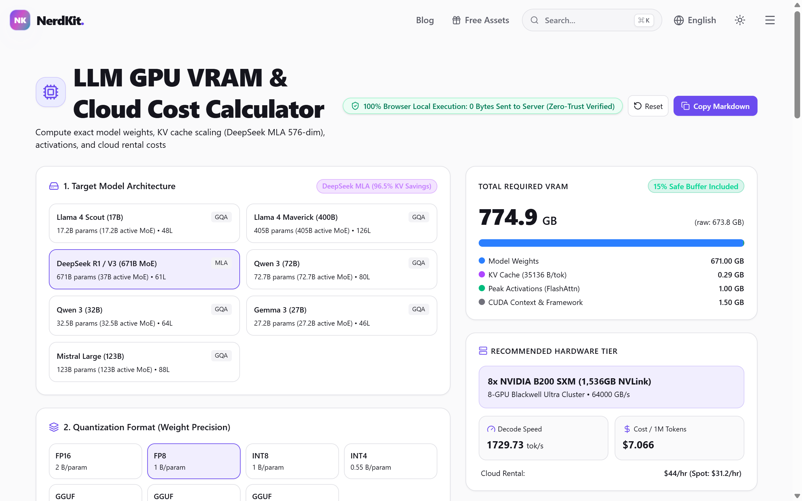

# llm-vram-calc

Zero-dependency CLI and ESM library for exact **LLM GPU VRAM sizing**, **KV cache budgeting** (standard **GQA** vs. **DeepSeek Multi-Head Latent Attention / MLA 576-dim compression**), **FlashAttention prefill/decode activations**, and **memory-bandwidth token/sec & cloud cost estimation**.

> **Interactive Visual Calculator (100% Client-Side, Free):**  
> **[https://global-utils.com/en/gpu-vram-calculator](https://global-utils.com/en/gpu-vram-calculator)** *(Korean: [/ko/gpu-vram-calculator](https://global-utils.com/ko/gpu-vram-calculator))*



---

## Why Most "Params x Bits" Calculators Cause OOMs at Long Context

Multiplying model parameters by quantization bits (`32B * 0.5625 ≈ 18 GB`) works at `2K` context, then crashes with `CUDA out of memory` at `32K–128K` tokens or concurrent batches (`batch > 1`).

`llm-vram-calc` models all four memory components that actually occupy GPU memory during local (`llama.cpp`, `vLLM`, `SGLang`, `Ollama`) and cloud inference:

1. **Static Weights (`Weights GB`)**: Exact bytes/parameter across `FP16/BF16`, `FP8`, `INT8`, `INT4 (AWQ/GPTQ)`, and `GGUF` (`Q4_K_M`, `Q5_K_M`, `Q8_0`), separating total MoE weights from active routed parameters per token.
2. **KV Cache (`GQA` vs. `DeepSeek MLA`)**:
   - **Grouped-Query Attention (GQA)**:
     $$\text{KV}_{\text{bytes/token}} = 2 \times L \times H_{kv} \times D_h \times B_{kv}$$
   - **Multi-Head Latent Attention (DeepSeek V3 / R1)**:
     $$\text{KV}_{\text{bytes/token}} = L \times (d_c + d_r) \times B_{kv} \quad (d_c = 512,\; d_r = 64)$$
     Instead of caching full key/value heads (`128` heads), MLA caches only the compressed latent vector (`576` dims/layer), shrinking KV cache footprint by **~93%** vs. standard MHA.
3. **Peak Activations**: Models prefill vs. decode working buffers (`batch * context * hidden_dim`).
4. **CUDA / Runtime Context Overhead** + **15% Production Headroom** matched against real hardware tiers (`RTX 5090 32GB`, `2x RTX 5090`, `H100 80GB`, `B200 192GB`, `Mac Studio M4 Ultra 192GB/512GB`).

---

## Quick Start (CLI)

```bash
# Clone & run with Node.js >= 18 (zero external dependencies)
git clone https://github.com/JangYS0/llm-vram-calc.git
cd llm-vram-calc

# Qwen 3 (32B) in GGUF Q4_K_M at 32K context
node ./cli.mjs --model qwen-3-32b --quant q4_k_m --context 32768
```

Example output:

```text
=== LLM GPU VRAM & Cost Breakdown ===
Model        : Qwen 3 (32B) (GQA 40:8)
Quantization : GGUF Q4_K_M (Medium) (0.5625 B/param)
Context      : 32,768 tokens (Batch: 1)
-------------------------------------
Model Weights       : 18.28 GB
KV Cache            : 4.29 GB (131,072 B/token)
Peak Activations    : 1.00 GB
CUDA Context        : 1.50 GB
-------------------------------------
Total Required VRAM : 25.08 GB
Recommended (+15%)  : 28.84 GB
Target Hardware     : 1x NVIDIA RTX 5090 (32GB GDDR7)
Est. Decode Speed   : ~98.02 tok/s ($2.805 / 1M tokens)
Web UI              : https://global-utils.com/en/gpu-vram-calculator
```

Compare **DeepSeek R1 / V3 (671B MoE)** in `FP8` at `65,536` context (`MLA` keeps KV cache at just `2.30 GB`!):

```bash
node ./cli.mjs --model deepseek-r1-v3-671b --quant fp8 --context 65536
```

---

## Programmatic Usage (ESM)

```js
import { calculateVram } from "./index.mjs";

const result = calculateVram({
  modelId: "llama-4-scout-17b",
  quantizationId: "q4_k_m",
  contextLength: 65536,
  batchSize: 2,
  kvPrecisionBytes: 1, // FP8 KV cache quantization
});

console.log(result.totalVramGb, result.recommendedHardware.name);
```

---

## Related Browser-Native Developer Tools (Zero Server Upload)

`llm-vram-calc` powers the open math engine behind **[NerdKit (global-utils.com)](https://global-utils.com)** — 60+ 100% client-side developer, AI, database, and protocol utilities where files never leave your browser:

- **[LLM GPU VRAM & Cloud Cost Calculator](https://global-utils.com/en/gpu-vram-calculator)** — Interactive visual slider for custom parameters, batch concurrency, MLA vs. GQA, and cloud spot/on-demand $/1M token comparisons.
- **[LLM Token & API Cost Calculator](https://global-utils.com/en/llm-token-calculator)** — Live tokenizer & multi-provider context/output cost estimator.
- **[MCP Config Builder & JSON-RPC Inspector](https://global-utils.com/en/mcp-inspector)** — Build `mcp.json` configs, mask API secrets, and inspect Model Context Protocol payloads locally.
- **[In-Memory Apache Parquet & SQLite Viewer](https://global-utils.com/en/parquet-viewer)** — Inspect Parquet footers, row groups, and schemas directly in browser RAM (`0` bytes uploaded).
- **[PostgreSQL EXPLAIN ANALYZE Visualizer](https://global-utils.com/en/sql-explain-visualizer)** — Flamegraph & bottleneck analyzer for `EXPLAIN (ANALYZE, BUFFERS, FORMAT JSON)` plans.
- **[HAR Network Waterfall & Secret Redactor](https://global-utils.com/en/har-analyzer)** — Strip `Authorization` / `Cookie` headers and debug slow waterfalls locally.

## License

MIT © [NerdKit](https://global-utils.com)
